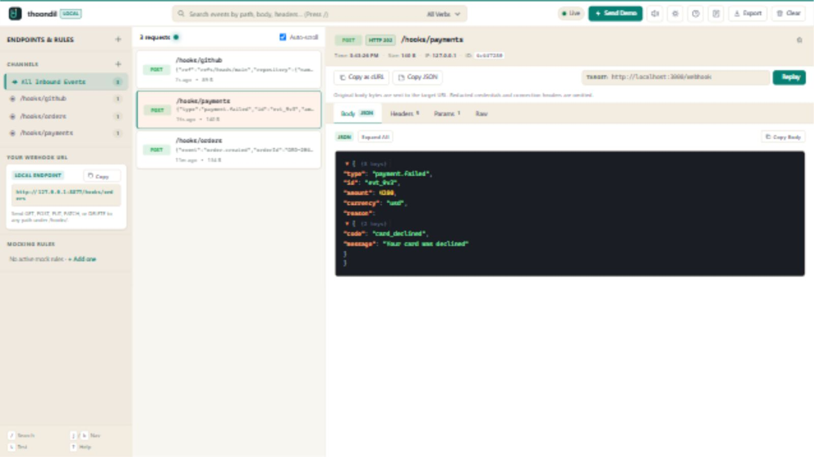

<p align="center">
  
</p>

<h1 align="center">Catch the request. Find the failure.</h1>

<p align="center">Thoondil (தூண்டில்) is a local-first webhook viewer built with Python's standard library.</p>

<p align="center">
  <a href="https://dheena731.github.io/Webhook-viewer/">Documentation</a> ·
  <a href="#quickstart">Quickstart</a> ·
  <a href="#security-and-limits">Security & limits</a> ·
  <a href="CONTRIBUTING.md">Contributing</a>
</p>



## What it does

Receive requests at named paths such as `/hooks/orders`, watch them arrive live, and inspect their method, decoded body, headers, query parameters, and response status. Search the feed, export current events, configure mock responses, or replay a captured request body to a local handler.

Thoondil needs no account, database, Redis, or frontend build step. Events and mock rules are **temporary** and disappear when the process restarts.

## Quickstart

Requires **Python 3.10+**. Runtime dependencies: none.

```bash
git clone https://github.com/Dheena731/Webhook-viewer.git
cd Webhook-viewer
python3 server.py
```

Open **http://localhost:8080** and click **Send Demo**, or send a request:

```bash
curl -X POST 'http://localhost:8080/hooks/orders?source=demo' \
  -H 'Content-Type: application/json' \
  -d '{"event":"order.created","id":"ord_42"}'
```

For Docker Compose:

```bash
docker compose up --build -d
```

Open **http://localhost:8090**. The published port binds to `127.0.0.1` by default. Use `WEBHOOK_VIEWER_PORT=9000 docker compose up --build -d` to change it.

## Inspect and replay

Select an event to inspect its body, headers, query, or event JSON. The desktop app has a three-pane layout; on mobile, selecting a request opens its detail view. Use **Back to requests** or Escape to return.

Replay sends the **original body bytes** and HTTP method to the target URL you enter. The target URL replaces the original path and query. Redacted credential headers and connection headers are omitted. Only HTTP(S) loopback targets and `host.docker.internal` are accepted; redirects are not followed. This is body-accurate replay, rather than a byte-for-byte copy of the entire HTTP request.

When Thoondil runs in Docker, `localhost` means the container. To reach an app on your host, use a target such as `http://host.docker.internal:3000/webhook`. Compose maps that name on Linux.

## API and configuration

See the [API reference](https://dheena731.github.io/Webhook-viewer/#reference) for capture, stream, export, replay, and mock-rule routes.

| Variable | Default | Purpose |
| --- | --- | --- |
| `HOST` | `127.0.0.1` | Interface for direct Python runs |
| `PORT` | `8080` | Server port |
| `MAX_EVENTS` | `500` | Maximum retained event count |
| `MAX_BODY_BYTES` | `1048576` | Maximum size of one request body |
| `MAX_TOTAL_BODY_BYTES` | `67108864` | Budget for retained original bodies |

The oldest events are evicted as the count or body budget is reached. The browser UI and API use the decoded event representation; original body bytes are kept privately in memory for replay.

## Security and limits

Thoondil has **no authentication**. Both direct Python runs and the default Compose port binding are local-only. External webhook providers need your own tunnel or a separately secured deployment. If you deliberately bind to a network interface, protect the dashboard and control API with an authenticated reverse proxy.

The app redacts `Authorization`, `Cookie`, `Proxy-Authorization`, `Set-Cookie`, and `X-API-Key` headers. Bodies, query parameters, and other headers may still contain secrets. Treat exports and screenshots as sensitive. Replay does not restore redacted credentials.

There is no persistent storage, hosted endpoint, automatic retry queue, or team account in this release.

## Documentation and development

The [documentation site](https://dheena731.github.io/Webhook-viewer/) is static and lives in [docs/](docs/). To publish it with GitHub Pages, choose **Deploy from a branch → master → /docs** in the repository's Pages settings. The same site is available at `/docs/` when running the app directly or through Docker.

Run the test suite:

```bash
python3 -m unittest discover -s tests -v
```

Contributions are welcome; read [CONTRIBUTING.md](CONTRIBUTING.md). Licensed under [MIT](LICENSE).
